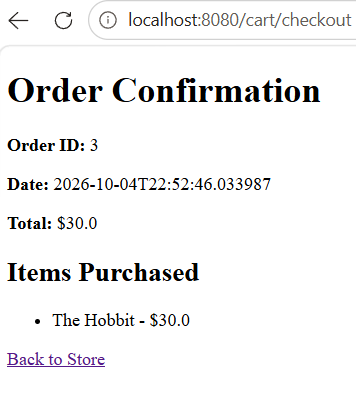
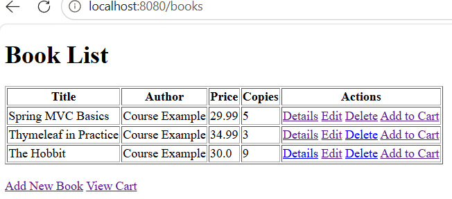
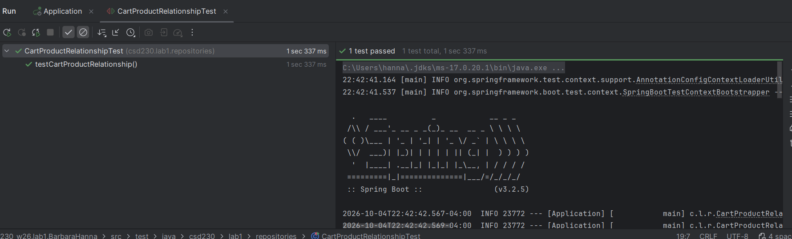

# Lab 2 CSD230 W26: Building a Transactional Bookstore with Spring MVC

## Overview
- Creating and persisting OrderEntity
- Implementing a Many‑to‑Many relationship between Order ↔ Product
- Calculating the total purchase amount
- Decrementing inventory stock (copies)
- Clearing the shopping cart after checkout
- Displaying an Order Confirmation page
- Demonstrating the full transactional flow in the browser

## UML Diagram

## OrderEntity (JPA Evidence)

.png)

## Project Structure

## Shopping Cart (cartDetails.html)

.png)

## Order Confirmation (orderDetails.html)

.png)

## Inventory Update (bookList.html)

.png)

## Application Configuration

# Functional Testing Summary

- Home — Book List (The Hobbit Copies: 10)

- Add — User adds a book to the cart

 

- Checkout >> Confirmation — Order Confirmation page

 

- Verification — Post‑checkout behavior (Copies changed from 10 → 9)

 

## Test Successful
- test confirms that the Cart ↔ Product Many‑to‑Many relationship is correctly implemented and functioning as expected.

